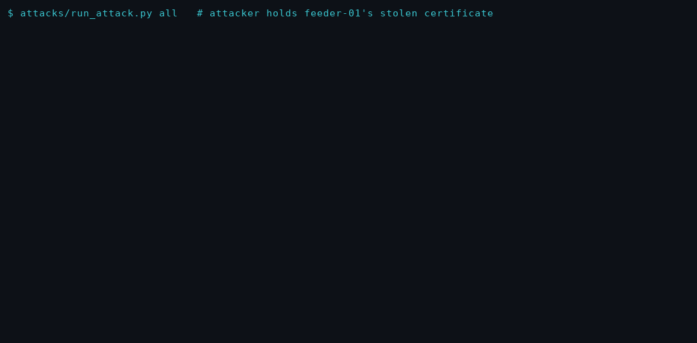
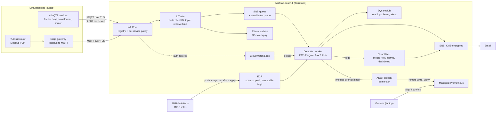
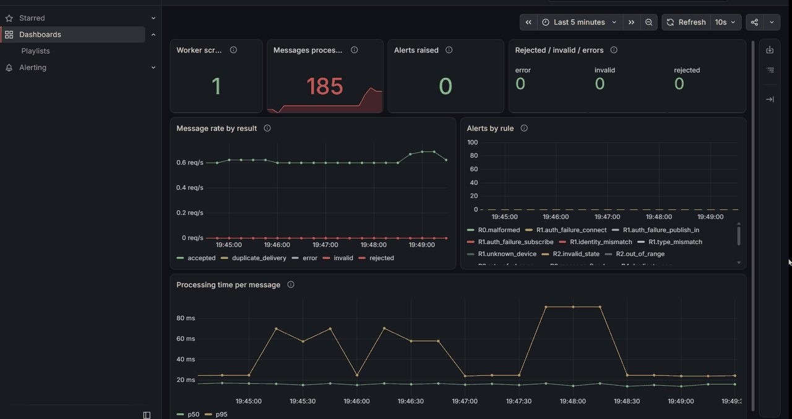

# Secure Industrial IoT Monitoring Platform (AWS)

[](https://github.com/purvankit/iiot-secure-monitor/actions/workflows/ci.yml)
[](https://github.com/purvankit/iiot-secure-monitor/actions/workflows/deploy.yml)

A cloud platform that ingests telemetry from simulated substation and factory devices over
mutually authenticated MQTT, stores it, and **detects and alerts on attacks**: rogue or
impersonated devices, spoofed sensor values, message floods and replayed messages. The replay
detection is modelled on IEC 61850 GOOSE `stNum`/`sqNum` sequencing.

All infrastructure is Terraform, and changes ship through GitHub Actions with OIDC (no stored
AWS keys) to ECS Fargate.

**Stack:** AWS IoT Core, SQS, S3, ECS Fargate, ECR, DynamoDB, SNS, KMS, CloudWatch, Amazon
Managed Service for Prometheus · OpenTelemetry (ADOT) · Grafana · Terraform · Docker · GitHub
Actions · Kubernetes (kind) · Helm · kube-prometheus-stack · Python · MQTT (TLS, X.509) ·
Modbus TCP · Trivy



## Why

Substations and factories are connecting OT devices to the cloud for monitoring. That needs
two things: telemetry that arrives reliably, and visibility when someone abuses the
connection. A stolen device certificate is the interesting case. TLS keeps outsiders out, so
the attacks that matter come from an identity the broker already trusts.

## Architecture



Key design decisions:

| Decision | Why |
|---|---|
| IoT Core instead of a self-hosted broker | Managed mutual TLS, per-device identity and policy-based authorization |
| One certificate per device, signed from a CSR | The private key is generated on the device and never leaves it |
| IoT policy: a device may publish only to `iiot/<its own id>/telemetry` | A stolen key can't write into another device's topic |
| The IoT rule stamps client ID, topic and receive time | The worker trusts broker-added fields and treats everything in the payload as attacker-controlled |
| SQS between IoT Core and the worker | Absorbs bursts, retries failed messages, parks poison messages in a DLQ after 5 attempts |
| Fargate, scaled to 0 when idle | No servers to patch; costs nothing while off |
| Public subnet, public IP, no inbound rules, no NAT gateway | The worker only calls out (port 443); a NAT gateway would bill every hour. Production alternative: private subnets + VPC endpoints |
| Exactly one worker at a time | Flood windows and sequence numbers live in one process; two workers would each see half the traffic |
| Metrics pushed by a sidecar to Managed Prometheus | Nothing can pull from a task with no inbound rules; the sidecar scrapes over localhost and pushes out. Decision record: [ADR 0001](docs/adr/0001-grafana-metrics-source.md) |

## Threat model

**Attacker:** holds one device's stolen certificate and private key (a compromised device or a
leaked credential). Attackers without a valid certificate are rejected at the TLS handshake.

| Threat | Example | Prevented by | Detected by |
|---|---|---|---|
| Rogue device | Unknown client connects | mTLS, certificate registry | Rejected before IoT Core logs it (see limitations) |
| Impersonation | Stolen feeder-01 key, payload claims `motor-01` | Policy pins topic to client ID | R1 identity mismatch (critical) |
| Cross-device publish | Stolen key publishes to motor-01's topic | Per-device IoT policy (PUBACK "Not authorized") | R1, from IoT Core `AUTHORIZATION_FAILURE` logs |
| Spoofed values | Frequency 55 Hz, or +0.9 Hz in 1.1 s | — | R2 range + rate-of-change limits |
| Flood / DoS | 50 messages in ~6 s from one device | SQS buffering | R3 per-device rate |
| Replay | Re-send a captured genuine message | — | R4 duplicate / old-session / stale checks |
| Poisoned state | Impersonator tries to reset the victim's sequence baseline | Messages failing R1 never update device state | Regression test |
| Supply chain | Malicious CI action or vulnerable base image | Actions pinned to commit SHAs; Trivy gate; immutable image tags | ECR scan on push |
| Over-privileged deploy | Compromised pipeline creates an admin role | Permissions boundary on every project role; deploy role can only touch bounded `iiot-*` roles | CloudTrail records it (no alerting yet) |

## Detection rules

| Rule | Detects | Signal |
|---|---|---|
| R1 identity | Unknown device, payload `device_id` ≠ broker client ID or topic, IoT Core authorization failures | Broker-added fields; CloudWatch `AWSIotLogsV2` |
| R2 plausibility | Physically impossible values or rates of change, invalid breaker state | Sensor limits per device type |
| R3 flood | More than 10 messages per device in 10 s (normal is 2) | Broker receive time, not the device's clock |
| R4 replay | Duplicate or old sequence number, old session after a reboot, stale (> 30 s) or future (> 5 s) timestamps | `session` + `seq`, like GOOSE `stNum` + `sqNum` |

Every alert is stored in DynamoDB with device, rule, severity and evidence, and emailed through
SNS (at most one email per device and rule every 5 minutes). Details:
[`service/README.md`](service/README.md).

## Demo: attacks and detection

The attacker uses feeder-01's stolen certificate and runs each attack in turn, while three
other devices keep sending normal traffic. `attacks/watch_alerts.py` prints each alert as the
Fargate worker stores it:

```bash
cd ~/projects/iiot-secure-monitor
export MQTT_HOST=$(terraform -chdir=infra/envs/dev output -raw iot_endpoint)
AWS_PROFILE=iiot .venv/bin/python attacks/run_attack.py all
```

**Measured results** (one run, 2026-11-27, worker on ECS Fargate). Detection time is the
alert's storage time minus IoT Core's receive time of the triggering message; both are AWS
clocks, so the laptop's clock skew doesn't affect it.

| Attack | Alerts raised | Detected in |
|---|---|---|
| Spoofed value (55 Hz, then +0.9 Hz in 1.1 s) | R2 out of range, R2 rate of change | 0.05 s, 0.08 s |
| Flood (50 messages in ~6 s) | R3 message flood ×1 | 0.05 s |
| Replay of a captured genuine message | R4 old session, R4 stale | 0.04 s, 0.09 s |
| Byte-identical duplicate | R4 duplicate seq | 0.04 s |
| Impersonation (feeder-01 key, payload claims motor-01) | R1 identity mismatch (critical) | 0.05 s |
| Publish to motor-01's topic | R1 auth failure (from CloudWatch Logs) | 62 s |

All 6 attacks were detected and all 8 alerts were expected ones. The foreign-topic publish is
slow by design: IoT Core rejects it, so the only evidence is its log, which the worker polls
every 60 s. False alarms: the three baseline devices sent 4,382 messages over ~3.5 hours that
day with **0 alerts** raised on them.

The same run on the Grafana dashboard (recorded live, sped up ~9×; one frame per 10 s refresh):



The flood shows as the message-rate spike, the alerts as bars per rule, the replayed and
impersonating messages as "rejected". Two notes on the counts: the window is the last
5 minutes, so the first alerts scroll out by the end; and the recording predates a dashboard
fix, so it shows Prometheus' extrapolated `increase()` values (a 0 → 1 step reads ~1.3). The
dashboard now rounds them to whole numbers.

## Running in AWS

**Fargate** (2026-11-26): the worker ran as a Fargate task with its least-privilege role. 47
simulated messages in 60 s were all stored in DynamoDB with 0 alerts. After the CI/CD pipeline
took over, a demo run on the CI-built image stored 24 of 24 messages, and one malformed message
produced one alert email through the KMS-encrypted SNS topic.

**Metrics path** (2026-11-27): the ADOT sidecar shares the task with the worker. Measured on
Fargate over ~3.5 hours: task memory 15.1% average, 15.2% peak of 512 MB (worker alone the day
before: 10.4% peak), CPU 9.0% average, 27.2% peak of 0.25 vCPU. Grafana on the laptop read
every panel from Managed Prometheus through SigV4.

**Alarms**, tested by forcing a real failure (a temporary deny on `dynamodb:PutItem`):

| Alarm | Fires when | Measured |
|---|---|---|
| `processing-errors` | The worker logs `processing failed` | ALARM ~66 s after the first failure, email sent |
| `dlq-not-empty` | A message failed 5 times and reached the DLQ | ALARM ~5 min after the messages were sent, email sent |
| `not-running` | `desired_count = 1` but no task reports metrics | Exists only while the worker should run |

## Local Kubernetes (stretch goal S1)

The same worker image also runs on a one-node **kind** cluster, deployed with a **Helm** chart
and watched by **kube-prometheus-stack**, against the same AWS pipeline. Guide:
[`k8s/README.md`](k8s/README.md).

| | ECS Fargate | Local Kubernetes (kind) |
|---|---|---|
| Image | CI-built, scanned, from ECR | The same image, loaded into kind |
| AWS access | Task role | `iiot-worker-local` role: the task role minus metrics push, 1-hour sessions, assumable only by one IAM user |
| Metrics | Sidecar **pushes** to Managed Prometheus (no inbound allowed) | Prometheus **pulls** through a ServiceMonitor |
| Network | Security group: no inbound, HTTPS out | NetworkPolicy: only the `monitoring` namespace in, HTTPS + DNS out |
| One worker at a time | Old task stops before the new one starts (min healthy 0, max 100) | `replicas: 1`, `Recreate` |

**Measured** (2026-11-27): 14/14 pods running, worker restarts 0. The worker ran as
`assumed-role/iiot-worker-local`. Prometheus scraped it (`up`), and the in-cluster Grafana
loaded the dashboard by itself: all 8 panels returned data, and "messages processed" matched
the simulator's count. NetworkPolicy probes: a connection from the `default` namespace and
the pod's outbound HTTP (port 80) were blocked; `monitoring` → worker and HTTPS out to AWS
were allowed. The whole cluster used 2.25 GiB RAM.

The chart's contract (hardening, limits, no static keys, NetworkPolicy, pins) is a frozen spec,
written before the code; five deliberate breaks of the chart were each caught by one test.

## CI/CD

```
pull request -> ci.yml:     ruff, pytest (simulator, service, repo guardrails, milestone specs),
                            terraform fmt / validate / test, docker build + Trivy
             -> deploy.yml: terraform plan with a read-only role
merge        -> deploy.yml: waits for manual approval, then build -> Trivy -> push image
                            tagged with the commit SHA -> terraform apply
```

- **No stored AWS keys.** GitHub's OIDC token is exchanged for 1-hour credentials. The plan
  role trusts only this repo's pull requests; the apply role trusts only jobs in the protected
  `dev` environment. Both match GitHub's immutable repository IDs, so a re-created repo with the
  same name can't assume them.
- **Permissions boundary.** The deploy role may create or change only `iiot-*` roles that carry
  a boundary listing exactly the actions the project uses. Even a role given admin rights
  can't exceed it, which closes the "create an admin role and use it" escalation path.
- **Supply chain.** Every third-party action is pinned to a commit SHA (in March 2026
  attackers re-pointed most `trivy-action` tags to malicious code, CVE-2026-33634). The Trivy
  binary version is pinned too.
- **Image choice from measurements.** Trivy 0.70, HIGH/CRITICAL findings: `python:3.12-slim`
  54 (53 with no fix released), `python:3.12-alpine` + `apk upgrade` 0. The CI-built image's
  ECR scan: 0 findings.
- `main` is protected: changes go through pull requests whose 4 checks passed.

## IEC 62443-3-3 mapping

Informal self-mapping of what this project implements to IEC 62443-3-3 system requirements.
It's a design aid, not an assessment, and no security level is claimed.

| FR | SR | Requirement | Implemented here | Gap |
|---|---|---|---|---|
| FR1 Identification and authentication | SR 1.2 | Software process and device identification and authentication | One X.509 certificate per device, mutual TLS to IoT Core | No certificate revocation workflow |
| FR1 | SR 1.5 | Authenticator management | Keys generated on the device; AWS signs CSRs, so private keys never leave the device | No automated rotation |
| FR2 Use control | SR 2.1 | Authorization enforcement | Per-device IoT policy (own topic only); least-privilege IAM; permissions boundary | — |
| FR2 | SR 2.8 | Auditable events | IoT Core authorization failures logged to CloudWatch; every alert stored in DynamoDB | Logs kept 7 days only (cost) |
| FR3 System integrity | SR 3.1 | Communication integrity | TLS from devices and gateway to IoT Core and on all AWS API calls; broker-stamped identity fields | PLC to gateway is plain Modbus TCP (no integrity protection), kept on the internal network |
| FR3 | SR 3.5 | Input validation | Strict schema validation; R2 physical plausibility checks; malformed messages alerted | — |
| FR4 Data confidentiality | SR 4.1 | Information confidentiality | TLS in transit; SSE on SQS, S3 and DynamoDB; customer KMS key on the alerts topic | — |
| FR5 Restricted data flow | SR 5.1 | Network segmentation | Modbus PLC reachable only through the edge gateway (Docker setup: no published port); worker accepts no inbound connections | Single VPC, no separate zones in AWS |
| FR6 Timely response to events | SR 6.2 | Continuous monitoring | Detection rules R1–R4; CloudWatch alarms; email alerts | No SIEM yet (planned: Wazuh) |
| FR7 Resource availability | SR 7.1 | Denial of service protection | SQS buffering; R3 flood detection | Detection, not throttling |
| FR7 | SR 7.6 | Network and security configuration settings | All infrastructure in Terraform; changes reviewed through PRs and plans | — |
| FR7 | SR 7.7 | Least functionality | Minimal Alpine image, non-root, read-only root filesystem, no inbound ports | — |

## Cost

Built to stay inside a **$5/month budget alert**. Rates below are indicative AWS list prices
(us-east-1), not a bill.

| Item | Billing | How it's kept low |
|---|---|---|
| ECS Fargate (0.25 vCPU, 0.5 GB) | ~$0.012 per task-hour | `desired_count = 0` unless demoing |
| Public IPv4 on the task | $0.005 per hour | Only while the task runs |
| KMS customer key (alerts topic) | ~$1 per month | The only fixed monthly cost |
| IoT Core | ~$1 per million messages | Simulator publishes every 5 s and only runs while working |
| Managed Prometheus | Per sample ingested, stored and queried | A few dozen series every 15 s, only while the worker runs: cents |
| DynamoDB, SQS, SNS | Per request | On-demand billing; tiny volumes |
| S3, CloudWatch Logs, ECR | Per GB | 30-day object expiry, 7-day log retention, last 10 images |
| NAT gateway, load balancer, EKS | Not used | Each would bill every hour even when idle |

## Limitations

- **TLS-level rejections aren't attributable.** Clients without a valid certificate never
  reach IoT Core's logs, so rogue devices are prevented but not detected.
- **A stolen key can still send plausible, in-sequence data.** Detection catches anomalies, not
  well-behaved misuse. Certificate revocation is the response.
- **Auth-failure alerts take ~1.5 min** because of log delivery and 60 s polling. A CloudWatch
  Logs subscription would make them near-real-time.
- **One worker only.** Detection state lives in memory; scaling out would need shared state,
  for example DynamoDB with conditional writes.
- **Replay window after a restart.** Only each device's last sequence number is restored, so
  a replay of a very recent message right after a worker restart isn't flagged.
- **Grafana runs on a laptop.** Amazon Managed Grafana bills per user, so dashboards are viewed
  locally with temporary `aws login` credentials. The Fargate deployment is watched by
  CloudWatch alarms whether or not Grafana is open.
- **Demo tooling depends on the laptop's network.** During recording, the laptop dropped DNS
  and its network route a few times; the cloud pipeline kept processing throughout.
- **Demo scale.** Results come from single runs with 5 simulated devices, not a long-running
  site. One region, no high availability, one dev environment.

## Repository layout

| Path | Contents |
|---|---|
| [`simulator/`](simulator/README.md) | Device simulator, Modbus PLC simulator, edge gateway, local mTLS broker setup |
| [`service/`](service/README.md) | Detection worker (rules R1–R4), Dockerfile, unit tests |
| [`infra/`](infra/README.md) | Terraform: modules (`iot`, `ingest`, `data`, `alerts`, `compute`, `ci_oidc`), `envs/dev`, `ci`, `bootstrap` |
| `attacks/` | Attack demo scripts |
| [`k8s/`](k8s/README.md) | kind cluster config, Helm chart for the worker, kube-prometheus-stack values |
| [`dashboards/`](dashboards/) | Grafana dashboard and provisioning (Managed Prometheus over SigV4) |
| [`docs/adr/`](docs/adr/) | Architecture decision records |
| `tests/` | Repo-wide guardrails (cost, region, least privilege, secrets) and frozen milestone specs |
| `.github/workflows/` | `ci.yml`, `deploy.yml` |

## License

MIT
